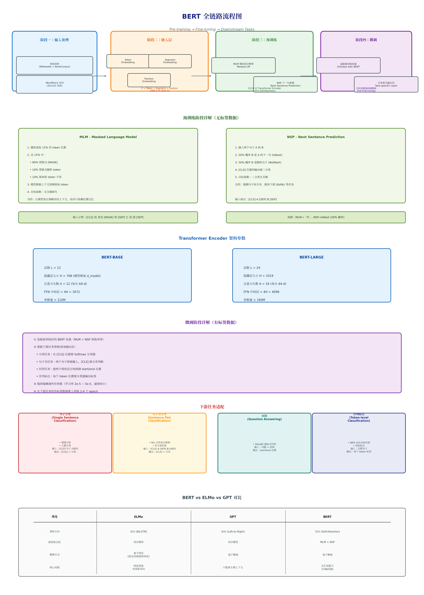
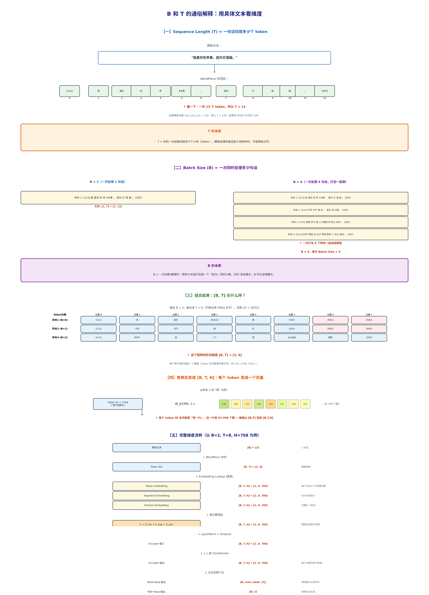
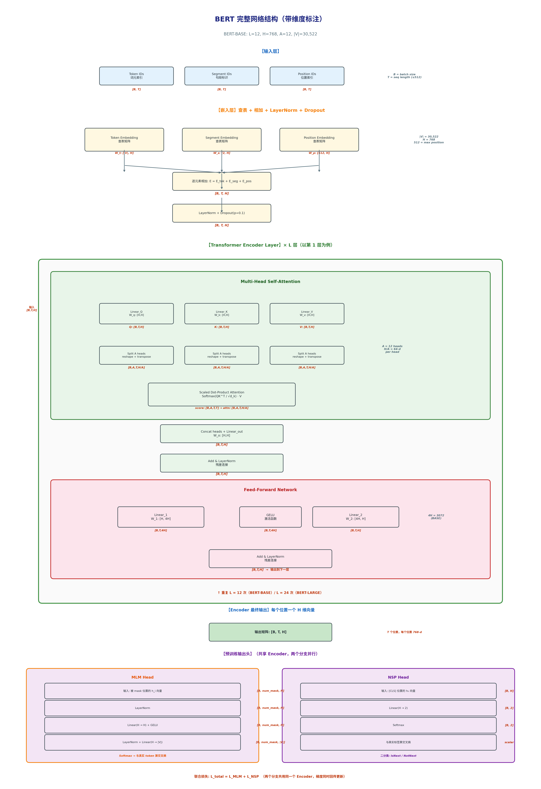
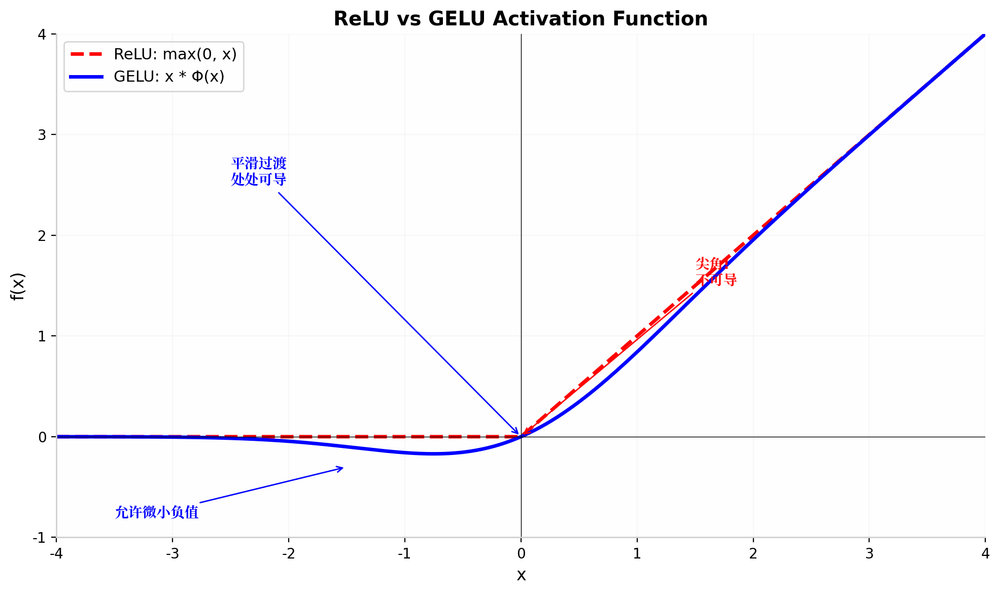
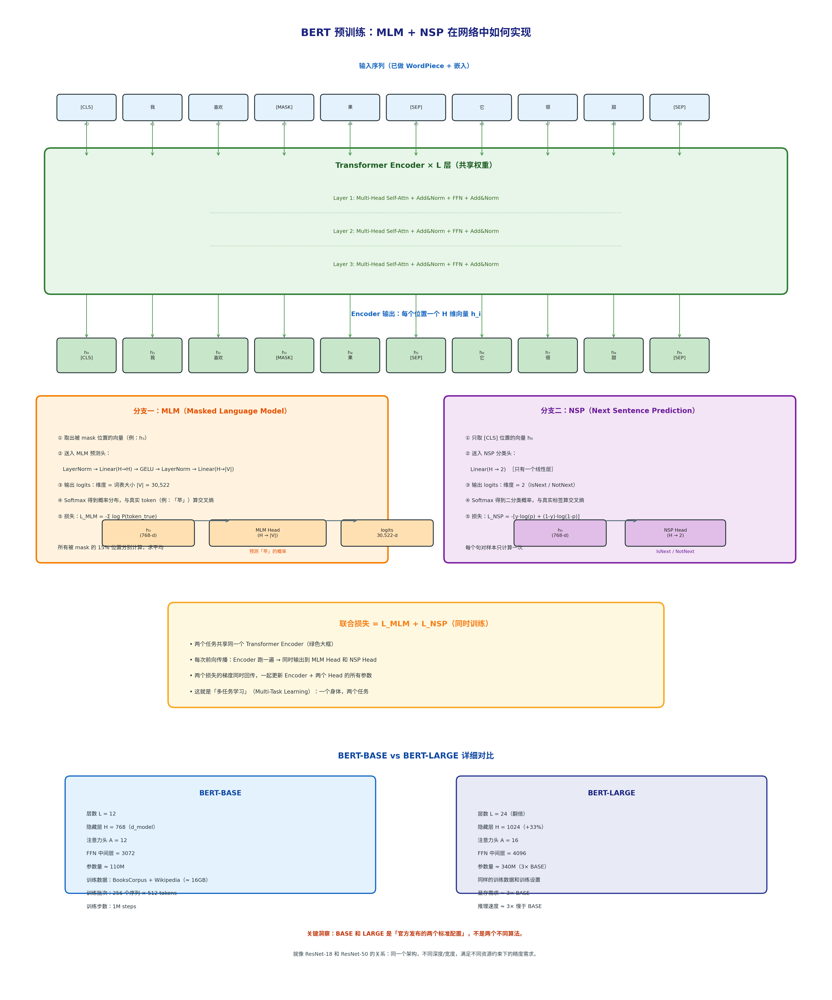
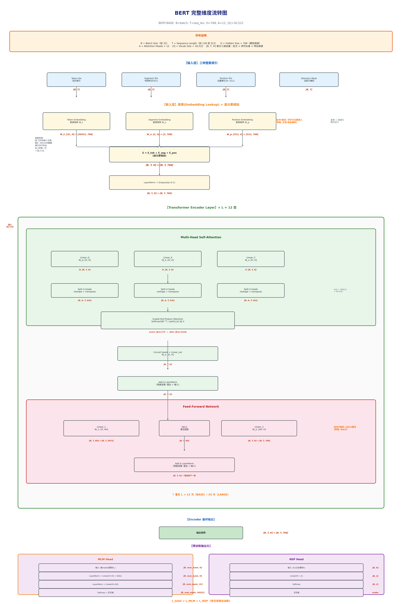

# BERT: Pre-training of Deep Bidirectional Transformers for Language Understanding 论文精读笔记

> 论文作者：Jacob Devlin, Ming-Wei Chang, Kenton Lee, Kristina Toutanova (Google AI Language)
> 论文发表于 NAACL 2019，是 NLP 预训练范式最具代表性的工作之一。
> 本笔记整理了论文核心思想（原始笔记整理 + 问答深度补充），全程以 BERT-BASE 的维度流转为主线，配图详解每个阶段。

---

## 一、整体认识：BERT 做了什么

BERT 的核心是**先预训练、后微调**的两阶段范式：

1. **预训练（Pre-training）**：在无标签的大规模语料（Wikipedia + BookCorpus，约 16GB）上，通过两个自监督任务（MLM + NSP）学习通用的语言表示。
2. **微调（Fine-tuning）**：在下游任务的有标签数据上，加载预训练好的权重，端到端微调所有参数，只需替换任务相关的输出层即可适配不同任务。

**关键认知**：预训练不只是"在大数据上跑一遍"，而是用两个专门为"深度双向理解"设计的自监督任务，强迫模型学到通用的语言表示。微调时也不是只调顶层，而是**端到端微调所有参数**——这是 BERT 与 ELMo（固定权重提特征）的本质区别。

BERT 的贡献可以概括为三点：
- **双向性**：用 MLM 实现了 Transformer 的**深度双向**预训练，突破了 GPT 单向自回归的局限。
- **基于微调**：整个模型参数在下游任务上联合优化，而不是像 ELMo 那样只提取固定特征。
- **通用性**：同一个预训练模型，只需换不同的输出头就能做分类、推理、问答、NER 等完全不同的任务。



---

## 二、BERT vs ELMo vs GPT

| 维度 | ELMo | GPT | BERT |
|------|------|-----|------|
| **架构方向** | 双向（BiLSTM） | 单向（Left-to-Right） | **双向（Self-Attention）** |
| **预训练目标** | 语言模型 | 语言模型 | **MLM + NSP** |
| **微调方式** | 基于特征（固定权重） | 基于微调 | **基于微调** |
| **双向性** | 浅层双向（特征拼接） | 单向 | **深度双向** |
| **核心局限** | 不是真正的深度双向 | 只能看左侧上下文 | 无生成能力（只有编码器） |

> BERT 的核心突破：**用 MLM 实现了 Transformer 的深度双向预训练**。ELMo 的 BiLSTM 是浅层双向（前后向分别编码再拼接），GPT 是单向自回归，而 BERT 通过"挖空填词"让模型真正同时利用左右两侧上下文。

---

## 三、输入处理：WordPiece 与维度符号

### 3.1 WordPiece 切词

BERT 不用传统的空格分词，而是用 **WordPiece** 算法把词拆成更细的子词单元（subword）：

- "playing" → `play` + `##ing`
- "苹果" → `苹` + `##果`
- 词表大小：**30,522**

这样做的好处是既能控制词表规模，又能避免 `<UNK>`（未知词）问题。

### 3.2 特殊 Token

| Token | 作用 |
|-------|------|
| `[CLS]` | 放在句首，用于分类任务的输出向量来源 |
| `[SEP]` | 句子分隔符，区分不同句子 |
| `[MASK]` | 预训练时替换被遮盖的词 |
| `[PAD]` | 补齐短句到固定长度 |

### 3.3 维度符号 B、T、H 的通俗解释

| 符号 | 含义 | BERT-BASE 取值 |
|------|------|---------------|
| $B$ | **Batch Size**，一次同时处理多少句话 | 如 $32$ |
| $T$ | **Sequence Length**，序列长度（token 数） | 如 $128$ 或 $512$ |
| $H$ | **Hidden Size**，模型维度/隐藏层大小 | $768$ |

**$T$ 的例子**：原始文本"我喜欢吃苹果，因为它很甜。"经 WordPiece 切词后：

```
[CLS]  我  喜欢  吃  苹  ##果  ，  因为  它  很  甜  。  [SEP]
  0     1    2    3   4    5   6    7    8   9   10  11   12
```

共 **13 个 token**，所以这句话的 $T = 13$。如果模型设置 `max_seq_len = 128`，后面会用 `[PAD]` 补齐到 128。

**$B$ 的例子**：$B = 4$ 表示一次打包 4 句话一起送进模型：

```
样本 1: [CLS] 我 喜欢 吃 ... [SEP]
样本 2: [CLS] 今天 天气 很 ... [SEP]
样本 3: [CLS] 深度 学习 是 ... [SEP]
样本 4: [CLS] BERT 模型 在 ... [SEP]
```

> GPU 显存越大，$B$ 可以设得越大。模型吃的是 $[B, T]$ 的整数矩阵，每个值是 token 在词表中的索引（如 101, 2769, 4263...）。



---

## 四、嵌入层：从 $[B, T]$ 到 $[B, T, H]$

### 4.1 三种嵌入

BERT 的嵌入是三层叠加：

$$
\mathbf{E} = \mathbf{E}_{\text{token}} + \mathbf{E}_{\text{segment}} + \mathbf{E}_{\text{position}}
$$

| 嵌入类型 | 作用 | 矩阵形状 |
|---------|------|---------|
| **Token Embedding** | 词本身的语义 | $\mathbf{W}_t \in \mathbb{R}^{|V| \times H} = \mathbb{R}^{30522 \times 768}$ |
| **Segment Embedding** | 区分句子 A 和 B（只有 0/1 两种） | $\mathbf{W}_s \in \mathbb{R}^{2 \times 768}$ |
| **Position Embedding** | 词在句中的绝对位置 | $\mathbf{W}_p \in \mathbb{R}^{512 \times 768}$ |

### 4.2 查表机制：$[B, T] \rightarrow [B, T, H]$

输入 Token IDs 是一个整数矩阵 $\mathbf{I}_{\text{token}} \in \mathbb{Z}^{B \times T}$，每个元素是 $[0, |V|-1]$ 范围内的整数。

**查表操作（Embedding Lookup）**：对于位置 $(i,j)$ 的整数索引 $k$，从 $\mathbf{W}_t$ 的第 $k$ 行取出一个 $H$ 维向量。

以 token "我"（ID = 2769）为例：

```
Token ID = 2769
    ↓
W_t[2769, :] = [0.12, -0.05, 0.33, ..., 0.08]  ← 一共 768 个数
    ↓
这个 768 维向量就是 "我" 的语义表示
```

对整个 $[B, T]$ 矩阵做查表后，每个整数变成 $H$ 维向量，形状变为 $[B, T, H]$：

$$
\mathbf{E}_{\text{token}} = \text{EmbeddingLookup}(\mathbf{I}_{\text{token}}, \mathbf{W}_t) \in \mathbb{R}^{B \times T \times H}
$$

三者相加后过 LayerNorm 和 Dropout（$p=0.1$）：

$$
\mathbf{H}^{(0)} = \text{LayerNorm}(\mathbf{E}_{\text{token}} + \mathbf{E}_{\text{seg}} + \mathbf{E}_{\text{pos}}) \in \mathbb{R}^{B \times T \times 768}
$$

> **BERT 与 Transformer 的差异之一**：原版 Transformer 用正弦/余弦位置编码（固定函数），而 BERT 使用**可学习的位置嵌入** $\mathbf{W}_p$，是训练出来的参数。这给了模型更大的灵活性，但也限制了最大序列长度（固定 512）。

---

## 五、模型架构：BERT-BASE vs BERT-LARGE

BERT 有两个官方发布的标准配置，就像 ResNet-18 和 ResNet-50 的关系：

| 参数 | BERT-BASE | BERT-LARGE |
|------|-----------|------------|
| 层数 $L$ | 12 | 24 |
| 隐藏层 $H$ | 768 | 1024 |
| 注意力头数 $A$ | 12 | 16 |
| 每头维度 $H/A$ | 64 | 64 |
| FFN 中间层 | $4H = 3072$ | $4H = 4096$ |
| 参数量 | **1.1 亿** | **3.4 亿** |
| 训练数据 | BooksCorpus + Wikipedia（≈16GB） | 同上 |

> **关于"隐藏层大小"**：笔记中提到 BERT"调整了隐藏层大小"，这里的 $H = 768/1024$ 是**整个模型的维度**（也叫 $d_{\text{model}}$），不是 FFN 中间层的维度。FFN 中间层是 $4H = 3072/4096$，是由 $H$ 推导出来的。**$H$ 才是基础配置参数**。



---

## 六、Transformer Encoder 内部结构

每个 Encoder Layer 包含两个子层：**Multi-Head Self-Attention** 和 **Feed-Forward Network**，每个子层外面都包着 **Add & LayerNorm**（残差连接 + 层归一化）。

### 6.1 Multi-Head Self-Attention

**输入**：$\mathbf{X} \in \mathbb{R}^{B \times T \times H}$

#### Step 1：生成 Q, K, V

三个独立的线性层，权重矩阵都是 $[H, H]$：

$$
\mathbf{Q} = \mathbf{X} \mathbf{W}_q, \quad \mathbf{W}_q \in \mathbb{R}^{H \times H} \;\Rightarrow\; \mathbf{Q} \in \mathbb{R}^{B \times T \times H}
$$

$$
\mathbf{K} = \mathbf{X} \mathbf{W}_k, \quad \mathbf{W}_k \in \mathbb{R}^{H \times H} \;\Rightarrow\; \mathbf{K} \in \mathbb{R}^{B \times T \times H}
$$

$$
\mathbf{V} = \mathbf{X} \mathbf{W}_v, \quad \mathbf{W}_v \in \mathbb{R}^{H \times H} \;\Rightarrow\; \mathbf{V} \in \mathbb{R}^{B \times T \times H}
$$

#### Step 2：Split Heads——多出来的维度就是"第几个头"

将 $H$ 维拆成 $A$ 个头，每个头维度 $d_k = H/A = 64$：

$$
\mathbf{Q} \in \mathbb{R}^{B \times T \times H} \xrightarrow{\text{reshape}} \mathbb{R}^{B \times T \times A \times (H/A)} \xrightarrow{\text{transpose}} \mathbb{R}^{B \times A \times T \times d_k}
$$

即：

$$
\mathbf{Q}_{\text{split}} \in \mathbb{R}^{B \times 12 \times T \times 64}, \quad \mathbf{K}_{\text{split}} \in \mathbb{R}^{B \times 12 \times T \times 64}, \quad \mathbf{V}_{\text{split}} \in \mathbb{R}^{B \times 12 \times T \times 64}
$$

**多出来的 $A=12$ 维度就是"第几个头"的索引**。每个头有自己独立的 $\mathbf{W}_q^{(i)}, \mathbf{W}_k^{(i)}, \mathbf{W}_v^{(i)}$，可以学到不同的关注模式——有的头关注语法关系，有的关注指代消解，有的关注语义相似度。

> **类比**：把病历复印 12 份，每份只看一个专科角度，12 个专家各司其职。

#### Step 3：Scaled Dot-Product Attention

$$
\text{Attention}(\mathbf{Q}, \mathbf{K}, \mathbf{V}) = \text{Softmax}\left(\frac{\mathbf{Q}\mathbf{K}^\top}{\sqrt{d_k}}\right)\mathbf{V}
$$

维度变化：

$$
\mathbf{Q}\mathbf{K}^\top: \; [B, A, T, 64] \times [B, A, 64, T] \;\rightarrow\; [B, A, T, T] \quad \text{(注意力分数矩阵)}
$$

$$
\text{Softmax}(\cdot) \cdot \mathbf{V}: \; [B, A, T, T] \times [B, A, T, 64] \;\rightarrow\; [B, A, T, 64]
$$

#### Step 4：Concat——把 12 个专家的意见拼起来

12 个头各自算出了结果，每个头的输出是 $[B, T, 64]$。但下一层 FFN 期望的输入是 $[B, T, 768]$。所以 **Concat 就是把 12 个头的输出沿着特征维度拼接**：

$$
\text{Concat}(\text{Head}_0, \text{Head}_1, \dots, \text{Head}_{11}) \in \mathbb{R}^{B \times T \times (12 \times 64)} = \mathbb{R}^{B \times T \times 768}
$$

> **类比**：12 个专家各自写了一份 64 字的诊断报告，Concat 把这 12 份报告按顺序粘成一沓 768 字的完整报告。

拼接后还要过一个线性层：

$$
\mathbf{O} = \text{Concat}(\cdot) \cdot \mathbf{W}_o, \quad \mathbf{W}_o \in \mathbb{R}^{H \times H} \;\Rightarrow\; \mathbf{O} \in \mathbb{R}^{B \times T \times H}
$$

这个 $\mathbf{W}_o$ 的作用是**让不同头之间的信息互相交流**——比如 Head 3 发现的"指代关系"可以影响 Head 7 的"语义理解"。


#### Step 5：Add & LayerNorm（残差连接）

$$
\mathbf{H}' = \text{LayerNorm}(\mathbf{X} + \mathbf{O}) \in \mathbb{R}^{B \times T \times H}
$$

残差连接是 BERT 能训练得很深的关键——信息可以从浅层直接跳到深层，缓解梯度消失。

### 6.2 Feed-Forward Network

**输入**：$\mathbf{H}' \in \mathbb{R}^{B \times T \times H}$

$$
\mathbf{Z} = \text{GELU}(\mathbf{H}' \mathbf{W}_1), \quad \mathbf{W}_1 \in \mathbb{R}^{H \times 4H} \;\Rightarrow\; \mathbf{Z} \in \mathbb{R}^{B \times T \times 4H} = [B, T, 3072]
$$

$$
\mathbf{O}_{\text{ffn}} = \mathbf{Z} \mathbf{W}_2, \quad \mathbf{W}_2 \in \mathbb{R}^{4H \times H} \;\Rightarrow\; \mathbf{O}_{\text{ffn}} \in \mathbb{R}^{B \times T \times H}
$$

$$
\mathbf{H}'' = \text{LayerNorm}(\mathbf{H}' + \mathbf{O}_{\text{ffn}}) \in \mathbb{R}^{B \times T \times H}
$$

FFN 的结构是 $H \rightarrow 4H \rightarrow H$，中间先膨胀到 4 倍维度，再压缩回来。

#### GELU 激活函数详解

> **BERT 与 Transformer 的差异之二**：原版 Transformer FFN 用 ReLU，BERT 改用 **GELU**。

**数学定义**：

$$
\text{GELU}(x) = x \cdot \Phi(x) = x \cdot \frac{1}{2}\left[1 + \text{erf}\left(\frac{x}{\sqrt{2}}\right)\right]
$$

其中 $\Phi(x)$ 是标准正态分布的累积分布函数（CDF），$\text{erf}$ 是误差函数：

$$
\text{erf}(z) = \frac{2}{\sqrt{\pi}} \int_0^z e^{-t^2} dt
$$

**代码中常用的近似实现**（因为 $\text{erf}$ 计算慢）：

$$
\text{GELU}(x) \approx 0.5x\left(1 + \tanh\left[\sqrt{\frac{2}{\pi}}\left(x + 0.044715x^3\right)\right]\right)
$$

**GELU 与 ReLU 的对比**：

| 特性 | ReLU | GELU |
|------|------|------|
| 公式 | $\max(0, x)$ | $x \cdot \Phi(x)$ |
| $x > 0$ 时 | 线性输出 $x$ | 近似线性，但略缓 |
| $x = 0$ 附近 | **尖角**（不可导） | **平滑过渡**（处处可导） |
| $x < 0$ 时 | **直接截断为 0** | **允许微小负值** |
| 梯度 | 0 或 1，不连续 | 连续平滑 |



**为什么 BERT 选 GELU？**

1. **平滑梯度**：ReLU 在 $x=0$ 处有个尖角，梯度从 0 突然跳到 1。深层网络里这种"硬切换"会导致训练不稳定。GELU 处处光滑，梯度变化柔和。
2. **允许微小负值**：ReLU 把负数全部抹成 0，导致"死亡神经元"问题。GELU 允许 $x<0$ 时有微小输出，保留了更多信息。
3. **概率解释**：GELU 可以看作"以概率 dropout 输入、以概率保留输入"的期望——当 $x$ 很大时大概率保留，当 $x$ 很小时大概率丢弃。这与 BERT 大量使用 Dropout（$p=0.1$）的设计理念天然契合。

### 6.3 BERT 与原版 Transformer 的所有差异总结

| 维度 | 原版 Transformer Encoder | BERT Encoder |
|------|------------------------|--------------|
| **位置编码** | 正弦/余弦函数（固定，不可学习） | **可学习的位置嵌入** |
| **激活函数** | ReLU | **GELU** |
| **归一化位置** | Post-LN（子层 → 残差 → LayerNorm） | **Post-LN**（同左） |
| **Dropout** | 有 | 有（$p=0.1$） |
| **层数 $L$** | 6 | **12 / 24** |
| **模型维度 $H$** | 512 | **768 / 1024** |

> **注意**：BERT 使用的是 **Post-LN**（先算子层，再加残差，最后 LayerNorm），和原版 Transformer 一致。后来的模型（如 GPT-3、LLaMA）普遍改用 **Pre-LN**（先 LayerNorm，再算子层），训练更稳定。这是 BERT 与 modern Transformer 的一个区别。

---

## 七、预训练任务：MLM + NSP

BERT 的预训练不是先练完 MLM 再练 NSP，也不是分开训练两个模型。它是一个**多任务学习（Multi-Task Learning）**框架：

$$
\mathcal{L}_{\text{total}} = \mathcal{L}_{\text{MLM}} + \mathcal{L}_{\text{NSP}}
$$

每次前向传播：Encoder 跑一遍 → 同时输出到 MLM Head 和 NSP Head → 两个损失相加 → 一次反向传播同时更新 Encoder + 两个 Head 的所有参数。

### 7.1 MLM（Masked Language Model）掩码语言模型

**为什么不用标准语言模型？** 标准语言模型（如 GPT）是单向的：预测下一个词只能看左边。BERT 想做**深度双向**理解，但如果直接用双向条件预测，每个词已经看到了自己，任务太简单（泄露答案）。

**MLM 的解决方式：挖空填词**

1. 随机选 **15%** 的 token 位置
2. 对这 15% 的位置，按以下比例处理：
   - **80%** 替换为 `[MASK]`
   - **10%** 替换为随机 token
   - **10%** 保持原 token 不变
3. 模型根据**左右双向上下文**预测这个位置**原来的 token**

> **为什么要有 10% 随机 + 10% 不变？** 如果只换 `[MASK]`，微调时输入里没有 `[MASK]`，预训练和微调会有 mismatch。保留一些原词和随机词，让模型学会"不管遇到啥都基于上下文判断"，减少 gap。

**损失函数**：交叉熵（只计算被 mask 的 15% 位置）

### 7.2 NSP（Next Sentence Prediction）下一句预测

MLM 只学了"词与词"的关系，BERT 还需要"句与句"的关系（问答、推理都需要）。

**做法**：
- 输入两个句子 A 和 B
- **50%** 概率 B 真的是 A 的下一句（标签：`IsNext`）
- **50%** 概率 B 是随机从语料里抽的（标签：`NotNext`）
- 取 `[CLS]` 位置的输出向量，接一个二分类器

**损失函数**：二分类交叉熵

**输入格式统一为**：
```
[CLS] 句子 A [SEP] 句子 B [SEP]
```

### 7.3 预训练头在网络中的实现

Encoder 最终输出 $[B, T, H]$，**同时**送往两个分支：



#### MLM Head 的结构

**输入**：被 mask 位置的向量 $\mathbf{h}_{\text{mask}} \in \mathbb{R}^{B \times M \times H}$（$M$ = mask 数量）

```
h_mask (768-d)
    ↓
LayerNorm
    ↓
Linear(H → H) + GELU
    ↓
LayerNorm + Linear(H → |V|)
    ↓
Softmax → 词表概率分布
```

$$
\mathbf{logits}_{\text{MLM}} \in \mathbb{R}^{B \times M \times |V|} = \mathbb{R}^{B \times M \times 30522}
$$

> **关键细节**：MLM Head 最后一层权重通常**与 Token Embedding 矩阵共享**（weight tying），即 $\mathbf{W}_{\text{MLM}} = \mathbf{W}_t^\top$。这样减少约 2300 万参数，同时利用"输入输出语义空间一致"的归纳偏置。

#### NSP Head 的结构

**输入**：只取 `[CLS]` 位置的向量 $\mathbf{h}_{\text{CLS}} \in \mathbb{R}^{B \times H}$

```
h_0 (768-d)
    ↓
Linear(H → 2)
    ↓
Softmax
    ↓
IsNext / NotNext
```

$$
\mathbf{logits}_{\text{NSP}} = \mathbf{h}_{\text{CLS}} \mathbf{W}_{\text{nsp}}, \quad \mathbf{W}_{\text{nsp}} \in \mathbb{R}^{H \times 2} \;\Rightarrow\; \mathbf{logits}_{\text{NSP}} \in \mathbb{R}^{B \times 2}
$$

> `[CLS]` token 的设计意图是聚合整个序列的全局信息，适合做句子级别的判断。NSP Head 极其简单，就是一个线性分类器。

---

## 八、微调阶段（Fine-tuning）

### 8.1 微调流程

1. **加载预训练权重**：把 MLM + NSP 训练好的参数全部加载
2. **替换输出层**：根据下游任务换不同的"头"
3. **端到端微调**：所有参数一起更新（学习率很小，通常 $2 \times 10^{-5} \sim 5 \times 10^{-5}$）
4. **训练 2-4 个 epoch**：不需要太多，预训练已经学得差不多了

### 8.2 为什么微调学习率要很小？

预训练权重已经在通用语言表示上收敛得很好，下游数据量通常不大。学习率太大会把预训练学到的通用知识"冲掉"（catastrophic forgetting）。

### 8.3 下游任务适配

BERT 的强大在于：同一个预训练模型，换不同的输出头就能做完全不同的任务。

| 任务类型 | 代表数据集 | 输出头设计 |
|---------|-----------|-----------|
| **单句分类** | SST-2（情感分析） | `[CLS]` → Softmax 分类器 |
| **句子对分类** | MNLI（自然语言推理） | `[CLS]` → 关系判断（同 NSP） |
| **问答** | SQuAD | 接两个线性层，分别预测答案的 **start** 和 **end** 位置 |
| **序列标注** | CoNLL-2003（NER） | 每个 token 位置接分类器，输出 BIO 标签 |

---

## 九、全链路维度流转总结

以 BERT-BASE（$B=2, T=8, H=768$）为例：



| 阶段 | 张量 | 形状 | 说明 |
|------|------|------|------|
| 原始文本 | "我喜欢吃苹果" / "今天天气很好" | — | 人看的文字 |
| 切词后 | `[CLS] 我 喜欢 ... [SEP]` | — | token 序列 |
| Token IDs | `[[101, 2769, ...], [101, 1921, ...]]` | **[2, 8]** | 整数矩阵 |
| Token Embedding | 查表 | **[2, 8, 768]** | 每个 token → 768 维向量 |
| Segment Embedding | 查表 | **[2, 8, 768]** | 句子 A/B 标识 |
| Position Embedding | 查表 | **[2, 8, 768]** | 位置 0~7 标识 |
| 相加 + LayerNorm | $\mathbf{E} = \mathbf{E}_{\text{tok}} + \mathbf{E}_{\text{seg}} + \mathbf{E}_{\text{pos}}$ | **[2, 8, 768]** | 最终输入 |
| Q/K/V 线性变换 | $\mathbf{X}\mathbf{W}_{q/k/v}$ | **[2, 8, 768]** | 生成 Q/K/V |
| Split Heads | reshape + transpose | **[2, 12, 8, 64]** | 12 个头，每头 64 维 |
| Attention Score | $\mathbf{Q}\mathbf{K}^\top$ | **[2, 12, 8, 8]** | 注意力分数矩阵 |
| Attention Output | Softmax + @V | **[2, 12, 8, 64]** | 每个头输出 |
| Concat + Linear | 拼接 + 混合 | **[2, 8, 768]** | 恢复 768 维 |
| FFN 中间层 | Linear$_1$ + GELU | **[2, 8, 3072]** | 膨胀到 4H |
| FFN 输出 | Linear$_2$ | **[2, 8, 768]** | 压缩回 H |
| Encoder 输出（×12 层） | — | **[2, 8, 768]** | 每个位置 768 维 |
| MLM Head | 预测 mask 词 | **[2, M, 30522]** | 词表概率 |
| NSP Head | 判断句对 | **[2, 2]** | IsNext/NotNext |

> **一句话总结**：BERT 的 $[B, T]$ 输入通过查表变成 $[B, T, H]$；Transformer Encoder 内部通过 Q/K/V 线性变换、多头拆分、注意力计算、FFN 膨胀-压缩，始终保持 $[B, T, H]$ 的维度流动；最终从 Encoder 输出的 $[B, T, H]$ 分别送入 MLM Head（预测词）和 NSP Head（判断句对关系）。

---

## 十、回顾：从原手稿到完整理解

原手稿的核心笔记：

> "预训练对语言模型效果很好，句子之间建模，词元之间建模。基于特征：elmo，基于微调：gpt，使用相同的目标函数，单向。双向突破局限性。掩码的 model：随机选取子元（挖空），允许看左右的信息，预测该字元；预测下一个句子。"

这些零散的关键词经过深入问答后，形成了以下完整图景：

1. **"预训练 + 微调"** → BERT 的两阶段范式，端到端微调所有参数
2. **"双向突破局限性"** → MLM 让 Transformer Encoder 实现了真正的深度双向理解
3. **"挖空预测字元"** → MLM 的 80/10/10 掩码策略，防止预训练-微调不匹配
4. **"预测下一个句子"** → NSP 让模型学会句子间关系
5. **"wordpiece + 三种嵌入"** → 子词切词 + Token/Segment/Position 三层叠加
6. **"调整 transform 块个数、隐藏层大小、头的数量"** → BERT-BASE/LARGE 的配置参数，$H$ 是模型维度不是 FFN 中间层
