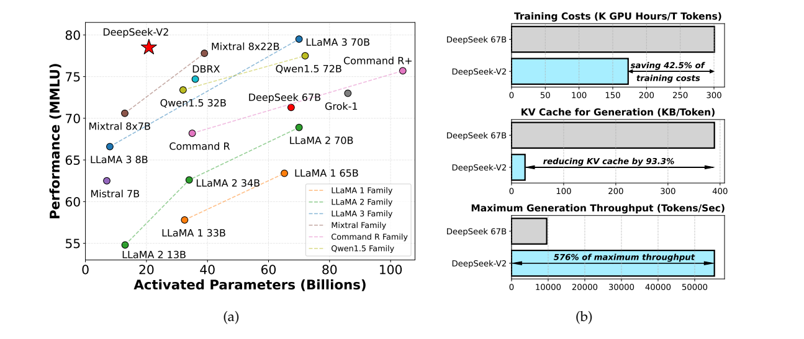
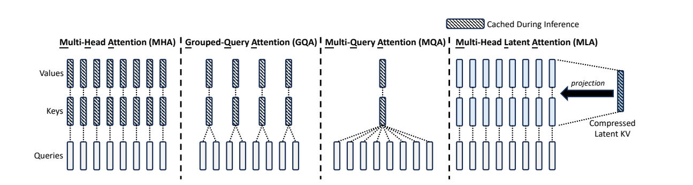
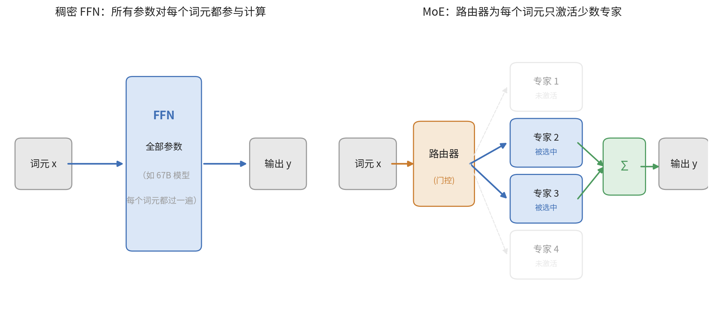
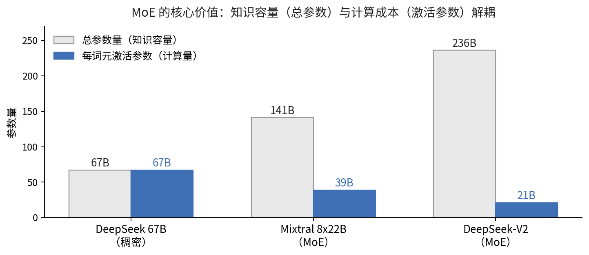
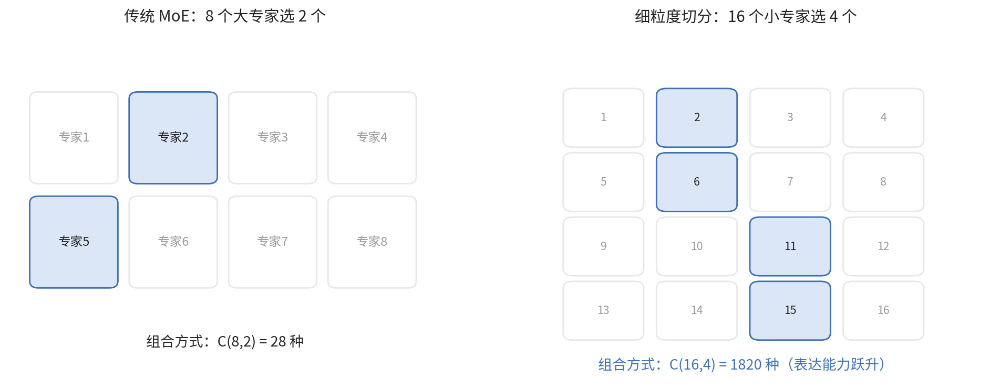
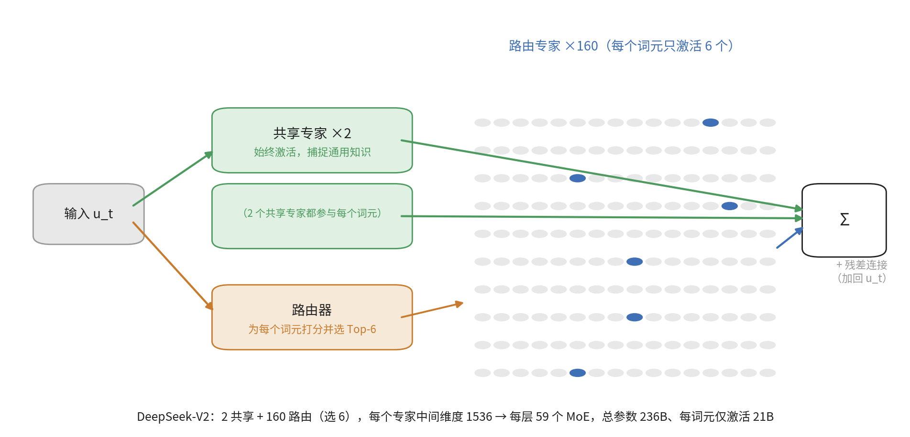
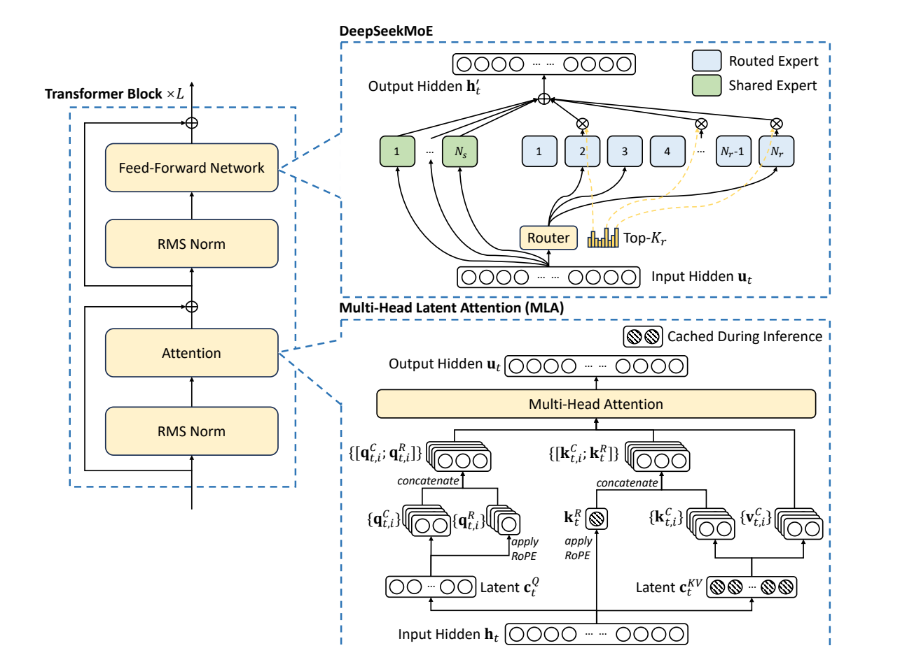
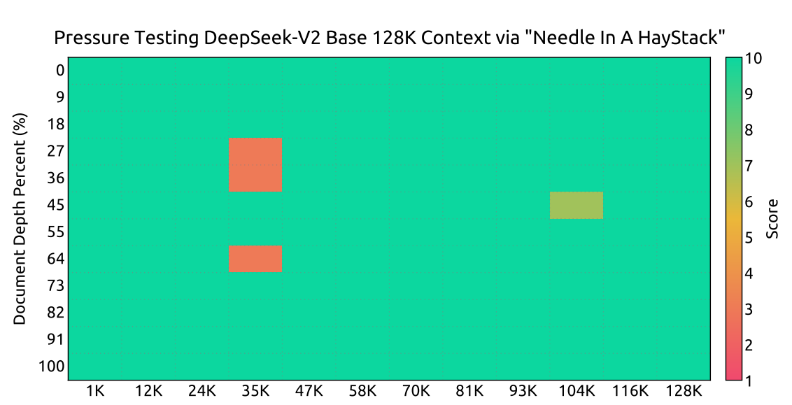

# DeepSeek-V2 学习笔记

> 论文：*DeepSeek-V2: A Strong, Economical, and Efficient Mixture-of-Experts Language Model*（arXiv:2405.04434v5，2024-06，DeepSeek-AI）
>
> 前置基础：仅 Transformer（2017）。笔记按"从已知到未知"的顺序组织，重点讲透两大架构创新 **MLA** 和 **DeepSeekMoE**，其余创新点列清单。
>
> 附件：
> - [deepseek-v2-arxiv2405.04434-中文译文.pdf](deepseek-v2-arxiv2405.04434-中文译文.pdf)：论文全文中文翻译（52 页全译，公式重排、图表重绘）
> - [MoE与DeepSeekMoE图解讲义.pdf](MoE与DeepSeekMoE图解讲义.pdf)：MoE 从零讲解的图解讲义（公式 TeX 排版 + 示意图）

---

## 〇、一句话总结

DeepSeek-V2 是一个 **decoder-only 的 MoE 语言模型**（236B 总参数 / 每词元激活 21B，128K 上下文），靠两个架构创新实现"强且便宜"：

- **MLA（多头潜在注意力）**：把 KV 缓存压缩成低维潜在向量 → 推理 KV 缓存降至 MHA 的约 1/57；
- **DeepSeekMoE**：细粒度专家 + 共享专家 → 以 21B 激活参数装进 236B 的知识容量。

相比 DeepSeek 67B：性能全面更强，训练成本 **-42.5%**，KV 缓存 **-93.3%**，最大生成吞吐 **×5.76**。

---

## 一、先厘清两个基础问题

**Q1：编码器还是解码器？**
纯**解码器**（decoder-only）。60 层 Transformer 块堆叠，每层 = 注意力（MLA）+ 前馈网络（DeepSeekMoE），因果掩码自回归生成。和 GPT/LLaMA 同一路线，没有编码器部分。

**Q2：论文里的"输入隐藏状态 h_t"是什么？**
就是**某一注意力层、第 t 个词元的输入向量**（5120 维）。第一层的 h_t ≈ 词嵌入+位置信息；第 37 层的 h_t 则是前 36 层加工后的结果。每层维度不变（残差流宽度 5120），每层都有自己独立的一套投影矩阵。

---

## 二、创新一：MLA（多头潜在注意力）

### 2.1 要解决的问题

标准多头注意力（MHA）生成时必须缓存每个词元所有头的 K、V：

$$
2 \cdot n_h \cdot d_h \cdot l = 2 \times 128 \times 128 \times 60 \approx 197\text{ 万元素/词元}
$$

GQA/MQA 靠"多个头共享 KV"省缓存，但性能下降。MLA 的目标：**缓存比 GQA 更小，性能比 MHA 更强**。

### 2.2 核心思路：存"压缩摘要"，不存完整 KV

$$
c_t^{KV} = W^{DKV} h_t \quad (5120 \to 512), \qquad k_t^C = W^{UK} c_t^{KV}, \quad v_t^C = W^{UV} c_t^{KV}
$$

- **下投影**：把 5120 维输入压成 **512 维**潜在向量 $c_t^{KV}$——推理时**只缓存它**；
- **上投影**：需要时再从 $c_t^{KV}$ 展开回 128 头 × 128 维的 K、V；
- 查询侧同样压缩（5120 → 1536 → 16384），但只为省训练显存，不减小缓存。

**权重共享的前提**：$W^{DKV}$、$W^{UK}$、$W^{UV}$ 是固定的可学习参数，同层内所有词元共享（和 $W^Q$ 一样）；每个词元不同的是输入 $h_t$，所以 $c_t^{KV}$ 各不相同。

### 2.3 矩阵吸收：连"解压"都省掉

注意力分数 $q^{\top} k^C = q^{\top} W^{UK} c^{KV}$，由矩阵乘法结合律，部署时把 $W^{UK}$ 预先并入查询矩阵、$W^{UV}$ 并入输出矩阵 $W^O$——**推理时根本不必把 512 维展开回 16384 维**，直接对压缩向量做注意力。

### 2.4 关键难点：RoPE 与低秩压缩不兼容

RoPE（旋转位置编码）给 q、k 乘上随位置变化的旋转矩阵 $R(m)$。若施加在压缩键上：$k = R(m)\, W^{UK}\, c^{KV}$，$R(m)$ 夹在中间无法预先吸收（矩阵乘法不可交换），推理时每生成一个词元都要为全部前缀重算键 → 效率崩塌。

**解法——解耦 RoPE**：内容（语义）走压缩路径，位置信息走独立的 64 维小通道：

$$
k^C = W^{UK} c_t^{KV} \;(\text{无位置，可吸收}), \qquad k_t^R = \mathrm{RoPE}(W^{KR} h_t)\;(\text{64 维，所有头共享})
$$

最终每头键 = $[k^C; k^R]$ 拼接（192 维）。推理时只需缓存 $c_t^{KV}$（512 维）+ $k^R$（64 维）。

### 2.5 效果

| 机制 | 每词元 KV 缓存 | 能力 |
|---|---|---|
| MHA | $2 n_h d_h l$ = 1,966,080 | 强 |
| GQA（8 组） | $2 n_g d_h l$ = 122,880 | 中等 |
| **MLA** | $(d_c + d_h^R) l$ = **34,560** | **更强** |
| MQA | $2 d_h l$ = 15,360 | 弱 |

约等于 2.25 组的 GQA，但论文消融（附录 D.2，16B 与 250B 两个规模）显示 MLA 性能反超 MHA。叠加部署量化后，相比 DeepSeek 67B 的 KV 缓存减少 93.3%。

### 2.6 附：RoPE 前置知识（只懂 Transformer 的视角）

原始 Transformer 把绝对位置编码**加**在输入词嵌入上，只加一次；RoPE 则是**每层注意力内部**把 q、k 按位置成比例**旋转**：

- 词元在位置 m，就把它的 q、k 旋转角度 mθ（128 维拆成 64 对，每对独立旋转，转速 $\theta_i = 10000^{-2i/d}$ 各不相同：快针感知近距、慢针感知远距）；
- 旋转不改变向量长度，语义内容保留；
- 最精妙的性质：$q_m \cdot k_n$ 只取决于**相对距离 m−n**，与绝对位置无关——这正是语言理解需要的。

---

## 三、创新二：DeepSeekMoE

### 3.1 MoE 基础（先铺底）

稠密 FFN 的矛盾：$y = W_2\,\sigma(W_1 x)$，想更聪明就要更大，但每个词元计算量同步变大——知识容量与计算成本被绑死。

MoE 的解法：N 个专家 + 一个路由器，每个词元只激活 Top-K 个专家：

$$
y = \sum_{i=1}^{N} g_i(x)\,E_i(x), \qquad s_i = \mathrm{Softmax}_i(x^{\top} W_g),\quad g_i = s_i\ (i \in \mathrm{TopK}),\ \text{否则 } 0
$$

直觉：医院分诊——医院可以有很多科室（知识容量大），但每个病人只去一两个科室（计算量小）。

经典陷阱是**路由塌缩**（少数专家垄断路由），用负载均衡辅助损失压制：$\mathcal{L}_{\mathrm{bal}} = \alpha \sum_i f_i P_i$。

### 3.2 改进一：细粒度专家切分

把专家切得更小更多、每个词元选得也更多（总激活参数不变）：

- 传统：8 选 2 → $C(8,2)=28$ 种组合；
- 细粒度：16 选 4 → $C(16,4)=1820$ 种组合；
- DeepSeek-V2 实际：**160 选 6** → 组合数是天文数字。

小专家专精度更高，不同词元"拼配"出最适合自己的处理流水线。

### 3.3 改进二：共享专家

通用知识（基础语法、常识）人人都用，全靠路由专家会重复学习。划出 $N_s=2$ 个**共享专家**始终激活，承载通用知识，路由专家安心钻专业。

### 3.4 完整公式

$$
h'_t = u_t + \sum_{i=1}^{N_s} \mathrm{FFN}_i^{(s)}(u_t) + \sum_{i=1}^{N_r} g_{i,t}\,\mathrm{FFN}_i^{(r)}(u_t)
$$

$$
s_{i,t} = \mathrm{Softmax}_i(u_t^{\top} e_i), \qquad g_{i,t} = s_{i,t}\ \text{若}\ s_{i,t} \in \mathrm{TopK}(\{s_{j,t}\}, K_r),\ \text{否则 } 0
$$

- $u_t$：第 t 个词元的 FFN 输入；$e_i$：第 i 个路由专家的中心向量（"专长画像"）；
- DeepSeek-V2：$N_s=2$，$N_r=160$，$K_r=6$，专家中间维度 1536；除第一层外 59 层全部 MoE 化。

---

## 四、其他创新点清单（非两大架构）

| 类别 | 创新 | 一句话 |
|---|---|---|
| 架构配套 | 设备受限路由 | 每词元最多发往 3 台设备，跨机通信可控 |
| 架构配套 | 三级均衡损失 | 专家级 0.003 / 设备级 0.05 / 通信级 0.02，通信级为新增 |
| 架构配套 | 词元丢弃策略 | 容量因子 1.0 + 约 10% 序列永不丢，训练-推理一致 |
| 系统 | 零气泡流水线 + 免张量并行 | 共享专家计算与 all-to-all 通信重叠，通信开销大减 |
| 系统 | 长上下文扩展 | YaRN 只作用于解耦共享键，32K 训练 1000 步外推 128K（NIAH 全绿） |
| 部署 | FP8 参数 + KV 6bit 量化 | 93.3% 缓存削减、5.76× 吞吐的重要来源 |
| 训练方法 | **GRPO 首次大规模验证** | 舍弃 critic 模型、组内相对优势，236B 规模上跑通（后演化为 R1 路线） |
| 训练方法 | 两阶段 RL | 先推理对齐（代码/数学 RM），再人类偏好对齐（有用+安全+规则多奖励） |
| 数据 | 预训练去偏 | 过滤地域文化争议内容；人工标注证明 MMLU 道德子集标注一致率仅 42–67% |

---

## 五、关键数字速查

- 结构：60 层，隐藏维度 5120；MLA 128 头 × 128 维，$d_c$=512，$d_c'$=1536，$d_h^R$=64
- MoE：2 共享 + 160 路由（选 6），中间维度 1536
- 规模：总 236B / 激活 21B，上下文 128K，预训练 8.1T 词元（中文比英文多约 12%）
- 效率：训练 17.28 万 GPU 小时/T 词元（67B 需 30.06 万）；单节点 8×H800 生成吞吐 >5 万词元/秒
- 对齐：SFT 150 万条（120 万有用性 + 30 万安全性）→ GRPO 两阶段 RL
- 开放评测：MT-Bench 8.97，AlpacaEval 2.0 长度控制胜率 38.9，AlignBench 7.91（中文超 GPT-4-Turbo-1106 之外的所有模型）

---

## 六、学习过程 Q&A（读论文时的真实疑问）

1. **h_t 和"词嵌入+位置编码"一样吗？** 第一层一样，后面各层是前面所有层加工后的结果；且 RoPE 不加在输入嵌入上，而是每层注意力内部旋转 q/k。
2. **每个词元的压缩矩阵权重一样吗？** 一样。同层所有词元共享一套 $W^{DKV}$/$W^{UK}$/$W^{UV}$（和 $W^Q$ 同理）；权重共享正是"缓存压缩态"和"矩阵吸收"能成立的前提。
3. **512 维压缩不损失信息吗？** 低秩压缩压掉的是键值空间中的冗余方向；消融实验证明同等缓存下 MLA 反而比 MHA 强——完整 KV 本身就高度冗余。
4. **为什么说 GRPO 影响最大（架构之外）？** 它省掉了与策略模型同等规模的 critic，首次在 236B 规模验证，后来直接演化为 DeepSeek-R1 的纯 RL 路线。

---

## 参考

- 原论文：https://arxiv.org/abs/2405.04434
- 代码与权重：https://github.com/deepseek-ai/DeepSeek-V2
- DeepSeekMoE 前置论文：arXiv:2401.06066；GRPO 前置论文（DeepSeekMath）：arXiv:2402.03300；RoPE（RoFormer）：Su et al., 2024
