# GPT 系列（GPT-1 / GPT-2 / GPT-3）论文精读笔记

> 三篇论文：
> - **GPT-1**：Radford et al., *Improving Language Understanding by Generative Pre-Training*（2018）
> - **GPT-2**：Radford et al., *Language Models are Unsupervised Multitask Learners*（2019）
> - **GPT-3**：Brown et al., *Language Models are Few-Shot Learners*（NeurIPS 2020）
>
> 本笔记整理自阅读原稿 + 问答深度补充。三篇论文一脉相承，主线是：**预训练目标始终不变（语言模型），变的是"下游任务怎么适配"**——GPT-1 靠微调，GPT-2 靠 zero-shot prompt，GPT-3 靠 few-shot 上下文学习。

---

## 一、三代总览

| | GPT-1（2018） | GPT-2（2019） | GPT-3（2020） |
|---|---|---|---|
| **参数量** | 117M（单档） | 四档，最大 1.5B | 八档，最大 175B |
| **层数 / 维度** | 12 / 768 | 12~48 / 768~1600 | 12~96 / 768~12288 |
| **词表** | BPE，40,000 merges | byte-level BPE，50,257 | 同 GPT-2 |
| **上下文窗口** | 512 | 1024 | 2048 |
| **训练数据** | BooksCorpus（约 7000 本书） | WebText（约 800 万网页 / 40GB） | 约 300B tokens 混合语料 |
| **下游适配** | **微调**（特殊符构造序列 + 更新权重） | **Zero-shot prompt**（不更新权重） | **Few-shot in-context learning**（不更新权重） |
| **核心论点** | 预训练 + 微调可行 | 语言模型 = 无监督多任务学习器 | 模型够大时，几个示例就会新任务 |

> **一句话总结**：GPT-1 证明"预训练 + 微调"可行；GPT-2 证明"不微调也能做任务"；GPT-3 证明"模型够大时，给几个例子就会新任务"。

---

## 二、GPT-1（2018）：打通「预训练 + 微调」

### 2.1 核心思想

- 在**没有标号的语料**上做预训练，目标就是标准的**语言模型**（预测下一个词）
- 预训练完成后，**根据具体任务调整参数**（有监督微调）
- 当时背景：无监督文本上词嵌入（word2vec 一类）是最好的表示方法；GPT-1 把"预训练一个深层模型再微调"这条路走通了

### 2.2 两阶段框架与目标函数

**预训练（L1）**：标准语言模型似然，模型为 Transformer **Decoder**，$k$ 为上下文窗口大小：

$$
L_1(\mathcal{U}) = \sum_{i} \log P(u_i \mid u_{i-k}, \dots, u_{i-1}; \Theta)
$$

**微调（L2 + L3）**：L2 是下游任务的有监督损失；总目标 L3 把语言模型当辅助目标一起优化，泛化更好：

$$
L_3 = L_2 + \lambda \cdot L_1
$$

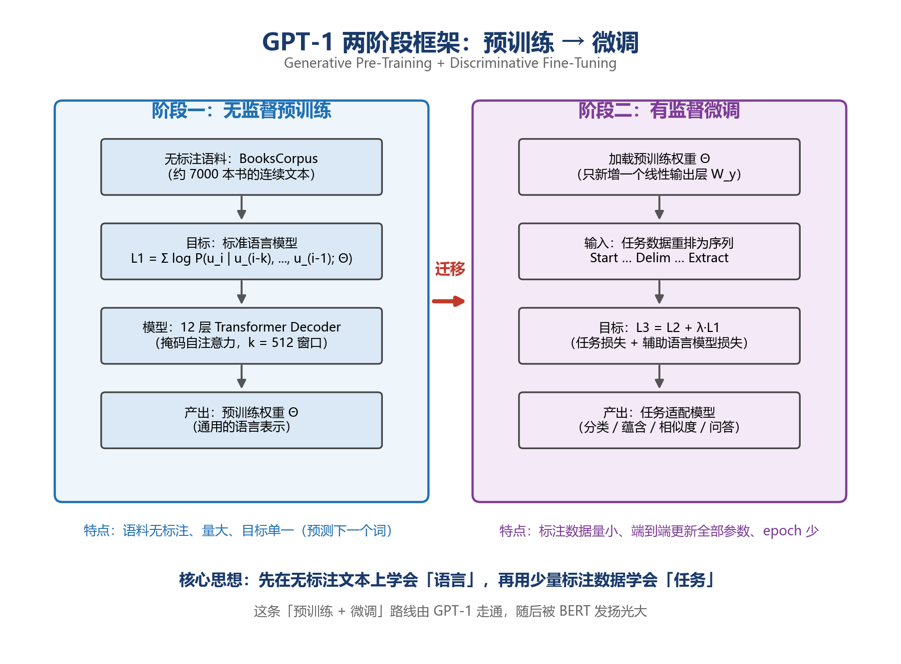

### 2.3 网络结构详解

整体一句话：**去掉编码器的 12 层 Transformer Decoder（只保留掩码自注意力），维度配置与 BERT-BASE 几乎一样**。

| 参数 | GPT-1 | 对照 BERT-BASE |
|------|-------|---------------|
| 层数 $L$ | 12 | 12 |
| 隐藏维度 $H$ | 768 | 768 |
| 注意力头数 $A$ | 12（每头 64 维） | 12 |
| FFN 中间层 | 3072 | 3072 |
| 最大序列长度 | 512 | 512 |
| 激活函数 | GELU（GPT 是最早用 GELU 的模型之一，BERT 沿用了它） | GELU |
| Dropout | 0.1 | 0.1 |
| 参数量 | 约 1.17 亿 | 1.1 亿 |
| 位置编码 | 可学习位置嵌入 | 可学习位置嵌入 |

**输入层只有两种嵌入**（没有 Segment Embedding，因为单向语言建模没有句子 A/B 的概念）：

$$
\mathbf{H}^{(0)} = \mathbf{W}_e[\text{token}] + \mathbf{W}_p[\text{position}]
$$

**每一层 Decoder Block**：Masked Multi-Head Self-Attention → Add & LayerNorm → FFN（768→3072→768，GELU）→ Add & LayerNorm。与原版 Transformer Decoder 的差异：**删掉交叉注意力**（没有编码器可用）；LayerNorm 沿用原版的 **Post-LN**（Pre-LN 是 GPT-2 才引入的改动）。

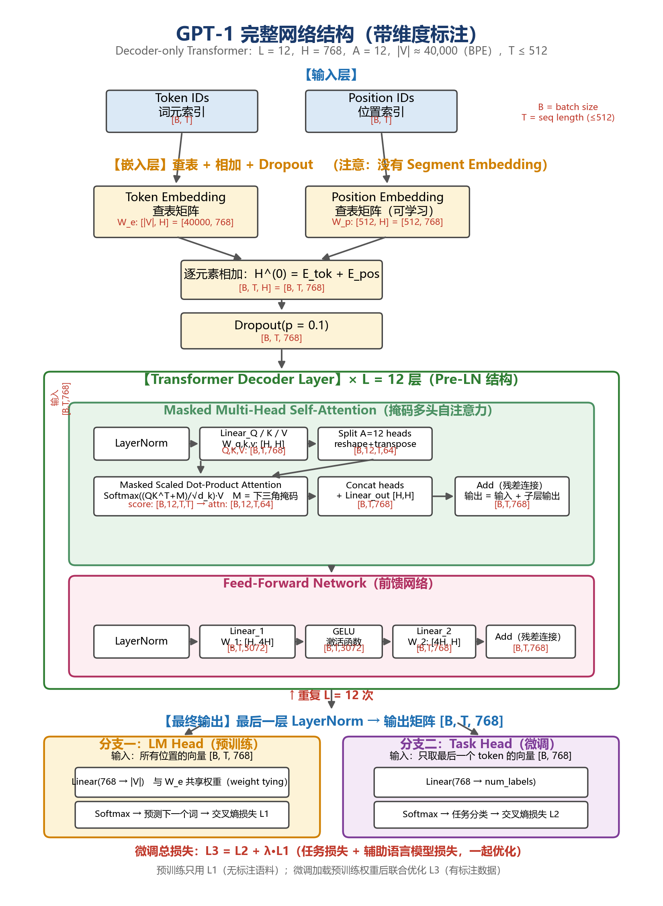

### 2.4 掩码自注意力：单向是怎么实现的

不是靠结构，而是靠在注意力矩阵上盖一个**下三角掩码**：

$$
\text{Attention}(\mathbf{Q}, \mathbf{K}, \mathbf{V}) = \text{Softmax}\left(\frac{\mathbf{Q}\mathbf{K}^\top + \mathbf{M}}{\sqrt{d_k}}\right)\mathbf{V}, \quad \mathbf{M}_{ij} = \begin{cases} 0, & j \le i \\ -\infty, & j > i \end{cases}
$$

位置 $i$ 只能 attend 到 $j \le i$（自己和左边）；加上 $-\infty$ 后 softmax 权重为 0，未来位置被屏蔽。

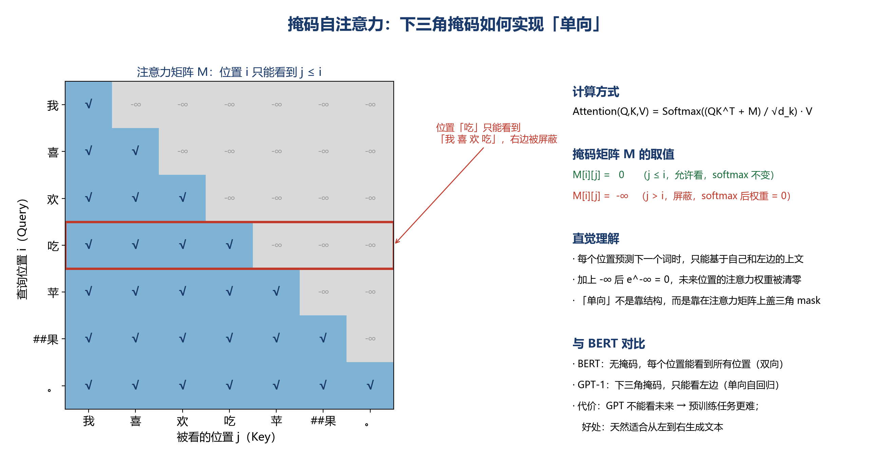

### 2.5 与 BERT 的对比

| 维度 | GPT-1 | BERT |
|------|-------|------|
| 预训练目标 | **标准语言模型**（单向，从左到右） | **带掩码的语言模型 MLM**（挖空填词） |
| 可见信息 | 只能看左侧上下文 | **双向**（左右都看） |
| 任务难度 | 只能看左边 → 预测更难 | 每个位置能看两边 → 预测相对"简单"，表示更强 |
| 微调取向量 | 取**最后一个 token**（只有它看全了上文） | 取 **[CLS]**（句首特殊 token） |
| 下游适配 | 微调（改输入格式） | 微调（换输出头） |

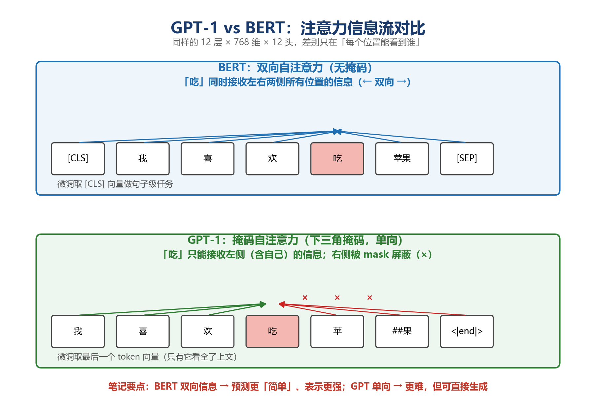

### 2.6 下游任务的输入适配

不同任务（分类、蕴含、相似度、问答）不改变模型结构，而是**把输入重排成一个序列**，用 **Start / Delim / Extract** 特殊符把不同部分隔开，取 Extract 位置的表示接线性层。注意：这些特殊符是**微调时才随机初始化的**，预训练从没见过——这正是 GPT-2 放弃特殊符号的动机。

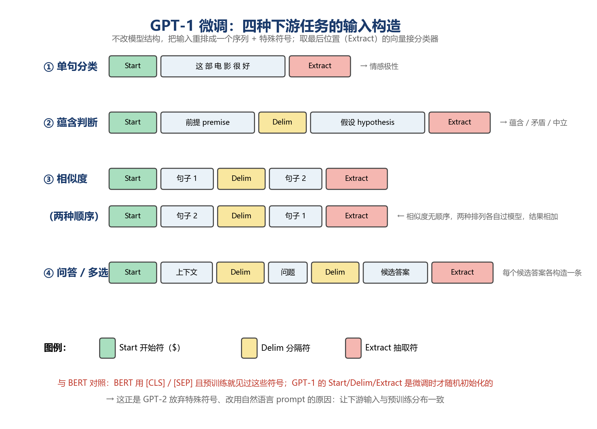

---

## 三、GPT-2（2019）：不微调也能做任务

### 3.1 核心主张

语言模型在足够大、足够多样的语料上训练后，**本身就是多任务学习器**——不需要为每个任务单独微调。任务从 P(输出｜输入) 变成 **P(输出｜输入， 任务)**，任务本身被写成自然语言条件。

### 3.2 结构变化（4 处小改）

1. **Pre-LN**：LayerNorm 从子层输出端移到输入端，最后一个 block 后追加最终 LayerNorm → 残差通路全程不碰归一化，梯度直通，48 层才训得动
2. **初始化**：残差分支权重按 $1/\sqrt{N}$ 缩放（N = 残差层数），防止加深时残差累加过大
3. **词表**：BPE 升级为 **byte-level BPE**（50,257），任何字节序列都能编码，彻底消灭 OOV
4. **规模**：117M 单档 → 四档（最大 1.5B，48 层 / 1600 维）；上下文 512 → 1024

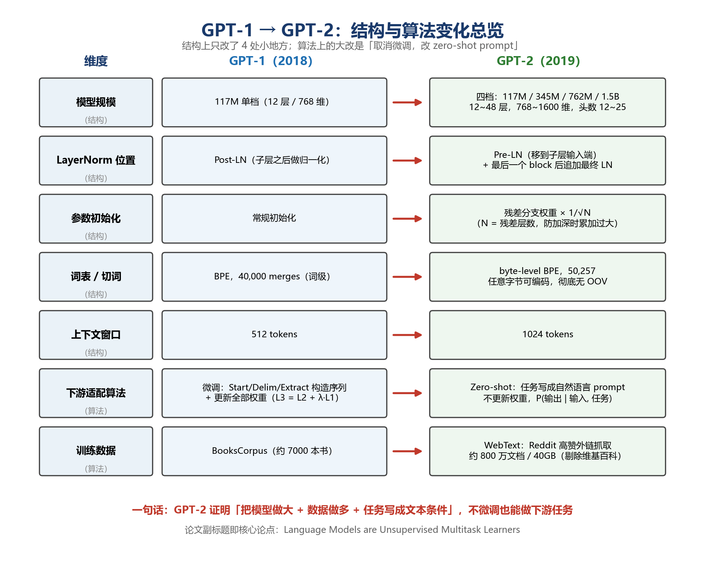

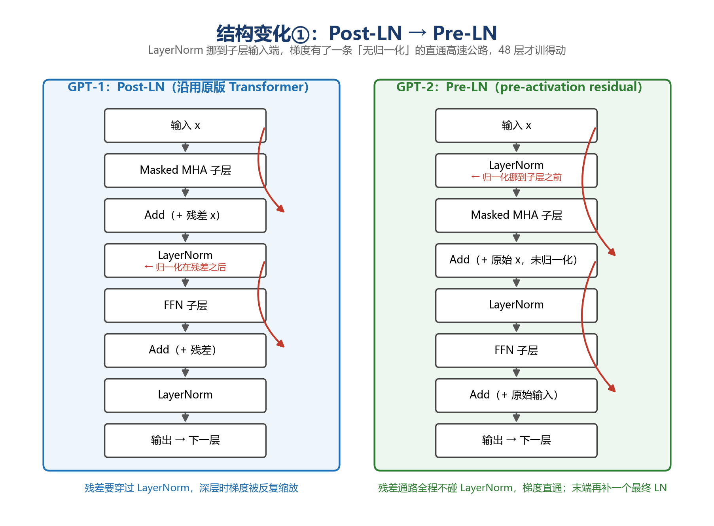

### 3.3 Zero-shot 的任务构造（prompt 的雏形）

- 下游任务**不需要标注信息**，**模型参数不做任何调整**
- 构造输入时**不能使用特殊符号**，必须**和预训练文本的自然分布保持一致**——用自然语言把任务"说"给模型听
- 例：翻译给 `translate to french: english text = french text`；摘要给 `{article} TL;DR:`，让模型续写

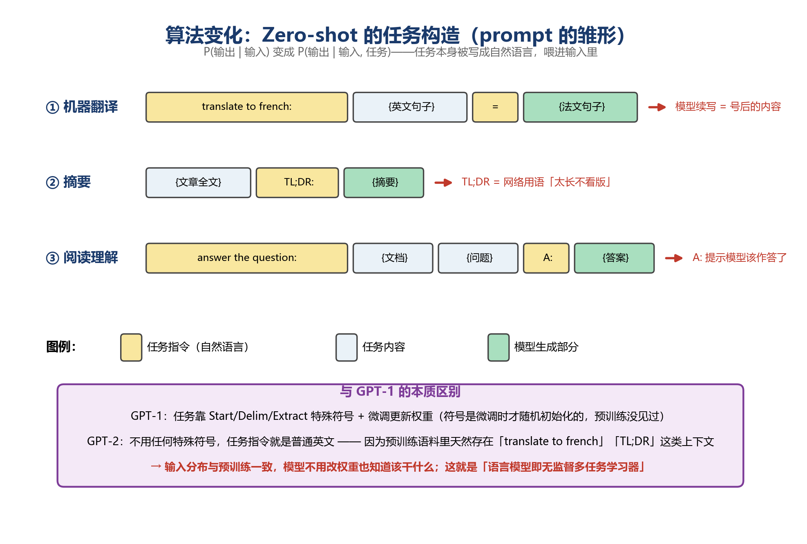

### 3.4 自建 WebText 数据集

GPT-1 用现成的 BooksCorpus；GPT-2 认为"多任务学习"的前提是数据足够多且足够干净：Reddit 高赞外链（karma ≥ 3）→ 抓取清洗 → 剔除 Wikipedia（防评测泄漏）→ 约 800 万文档 / 40GB。不用 Common Crawl 是因为 OpenAI 认为其质量太差。

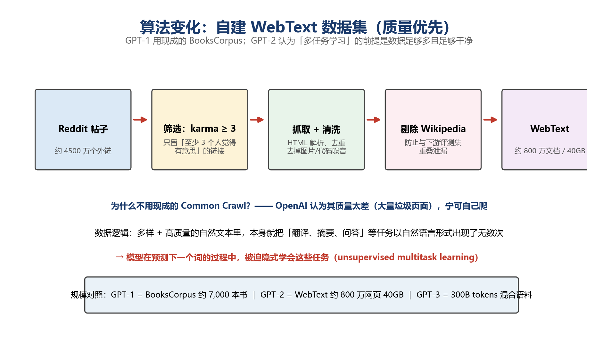

---

## 四、GPT-3（2020）：示例进上下文

### 4.1 动机：对"预训练 + 微调"的三点质疑

1. **标注问题**：每个子任务都要对应数据集，标注困难、昂贵
2. **微调效果好 ≠ 预训练好**：微调高分可能来自对小数据分布的过拟合，不代表模型真的"理解"
3. **对比人类**：人类学新任务**不需要大量数据集**，看几个例子就会了

### 4.2 核心机制：Meta-learning + In-context learning

- **Meta-learning（外循环）**：预训练一个很大的模型，海量文本里每个序列都像一个"任务样本"，预测下一个词强迫模型识别任务模式，练出"从上下文学任务"的元能力（更新权重，泛化性不错）
- **In-context learning（内循环）**：推理时把示例直接写进上下文，模型**不再更新任何权重**，"学习"完全发生在一次前向传播的注意力计算里

> 因为模型太大（175B），应用到子任务时不做梯度更新既是设计选择，也是工程必然。

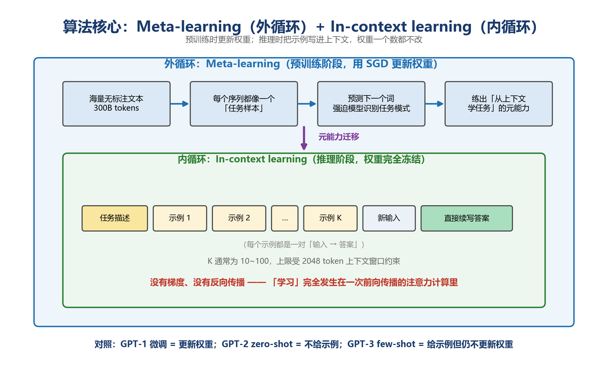

### 4.3 三种设定（与微调对比）

| 设定 | 上下文中的内容 | 权重 |
|------|--------------|------|
| 微调（GPT-1/BERT） | —（用标注集训练） | **更新** |
| **Zero-shot**（GPT-2） | 只有任务描述 | 不动 |
| **One-shot**（GPT-3） | 任务描述 + 1 个示例 | 不动 |
| **Few-shot**（GPT-3） | 任务描述 + K 个示例（10~100，受 2048 窗口限制） | 不动 |

实验结论：同一任务上 **Few-shot > One-shot > Zero-shot**，且模型越大，示例带来的提升越明显。

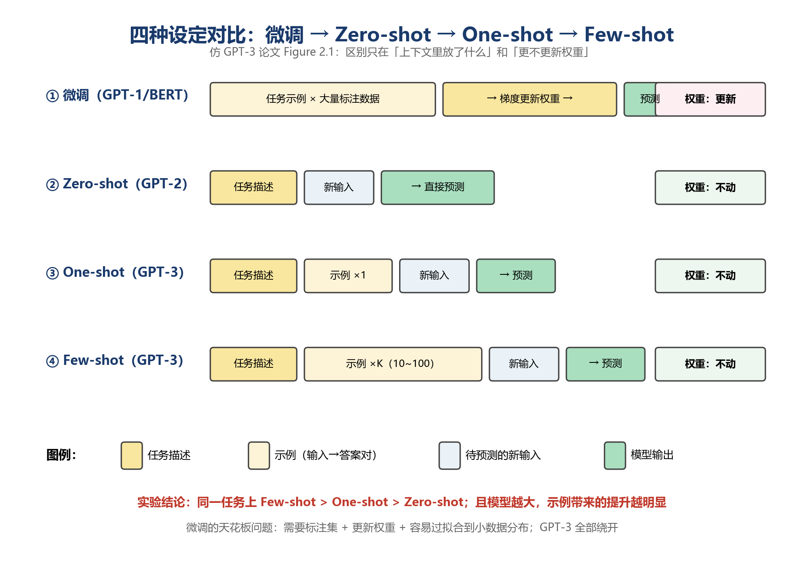

### 4.4 结构与数据变化

结构只剩"更大 + 稀疏注意力"：八档家族（125M → 175B），最大档 96 层 / 12288 维 / 96 头；交替使用**稠密 + 局部带状稀疏注意力**（借鉴 Sparse Transformer）控制算力；上下文 1024 → 2048。数据换成约 300B tokens 混合语料：过滤版 Common Crawl（60%）+ WebText2（22%）+ 图书（16%）+ 维基百科（3%），按质量加权采样。

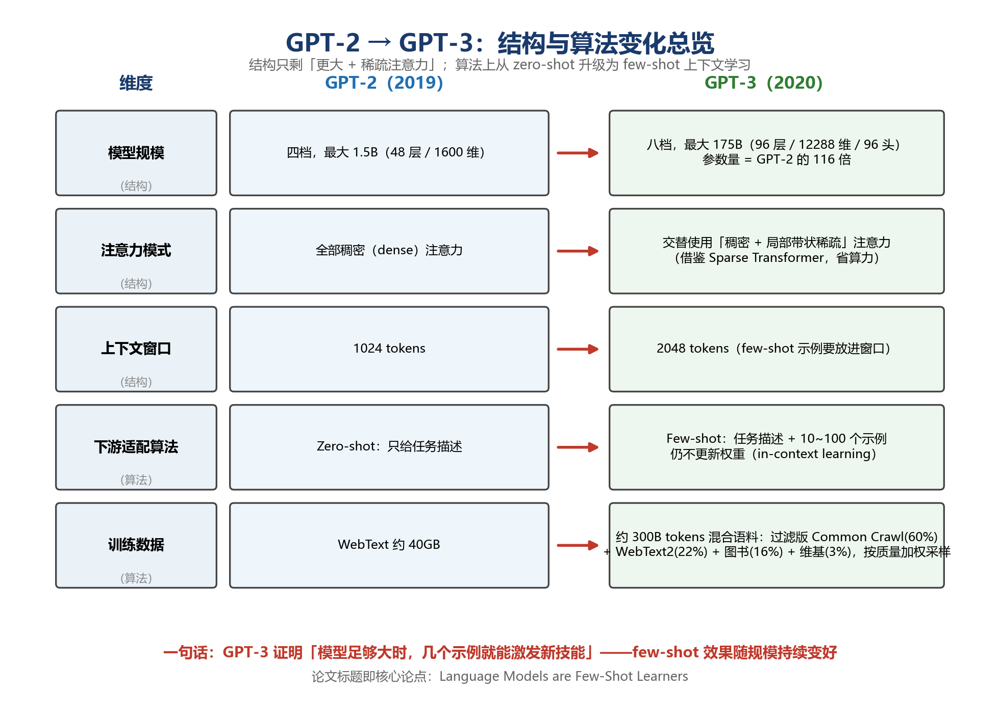

### 4.5 八档模型家族与规模定律

八档同架构、同数据，只改规模——目的是隔离出"规模"这个变量。结果：few-shot 性能随参数量持续提升，且与 zero/one-shot 的差距随规模拉大，说明**大模型更会"用示例"**。这就是 GPT-3 敢只做 zero/few-shot 的底气。

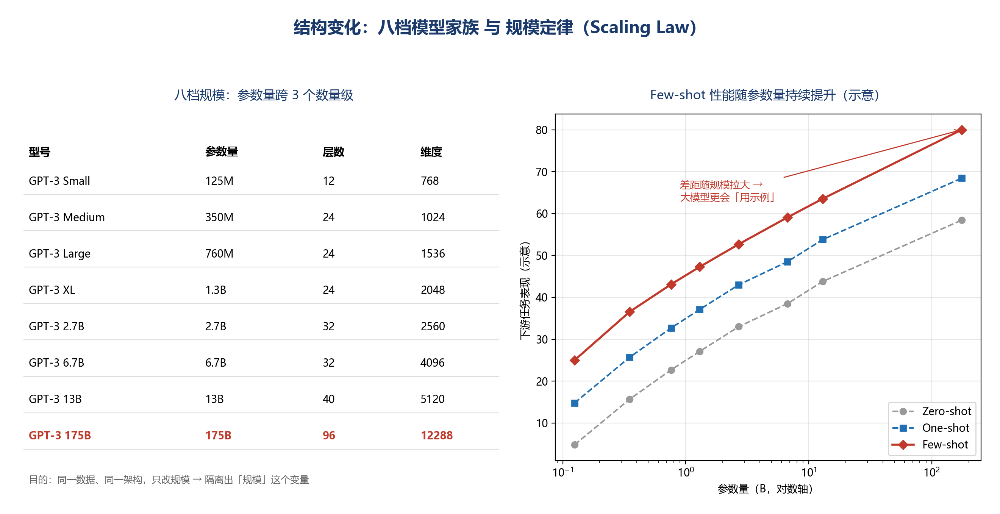

---

## 五、回顾：三代演进链条

1. **GPT-1（2018）**：立框架——无标注语料语言模型预训练 + 特殊符构造输入 + 端到端微调（L3 = L2 + λ·L1）
2. **GPT-2（2019）**：取消微调——Pre-LN 等 4 处结构小改 + 规模 ×13，任务写成自然语言 prompt，zero-shot 直接推理
3. **GPT-3（2020）**：示例进上下文——规模 ×116 + 稀疏注意力，few-shot in-context learning，权重全程冻结

> 对照 BERT 路线：BERT 把"预训练 + 微调"做到极致（双向表示）；GPT 系列则一路走向"不微调"——从 GPT-1 的必须微调，到 GPT-2 的 zero-shot，再到 GPT-3 的 few-shot 上下文学习。两条路线在 2018 年同量级竞争，最终 GPT 路线演化成了今天的大模型范式。
